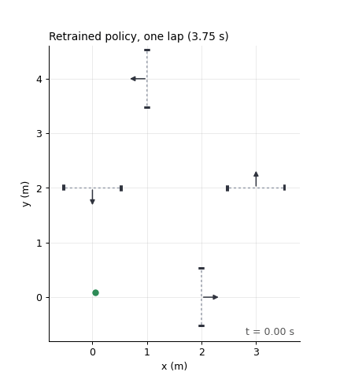
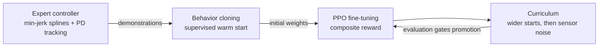
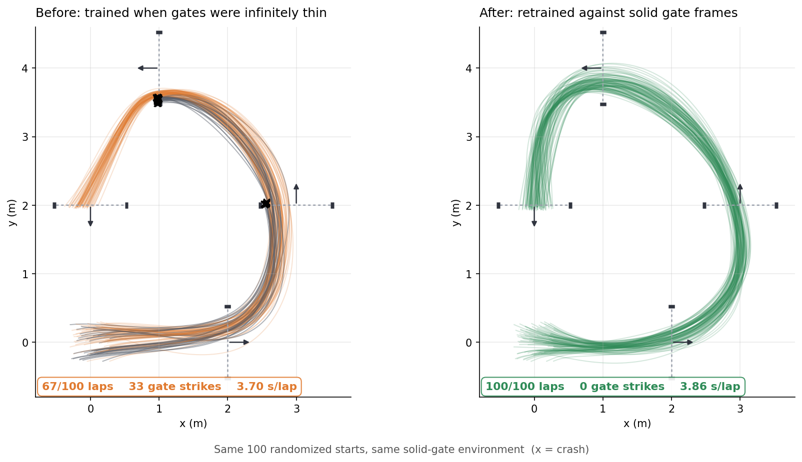
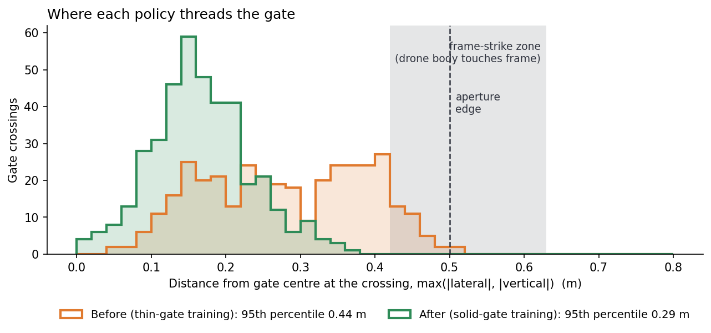

# Golden Snitch: Autonomous Drone Racing with Reinforcement Learning

A quadrotor racing agent that learns to fly a gate course as fast as possible without crashing. It's trained with imitation learning and PPO, and evaluated by checking what each metric is actually measuring.

<p align="center">
  
</p>

<p align="center">
  
  
  
  
  
</p>

## Results

Each policy was evaluated over the same 100 episodes. Each episode starts from a random point up to 0.3 m from the start position.

| Policy | Gate model it was scored on | Laps completed | Gate strikes | Mean lap time |
|---|---|---|---|---|
| PPO, trained with thin gates | Thin (original) | 100 / 100 | — | 3.71 s |
| PPO, trained with thin gates | **Solid frames** | **67 / 100** | **33** | 3.70 s |
| **PPO, retrained with solid frames** | **Solid frames** | **100 / 100** | **0** | **3.86 s** |

The first policy's perfect score wasn't real. The simulator treated each gate as an infinitely thin window, so the policy learned to cut corners by clipping gate edges it couldn't hit. Once I made the gate frames solid, a third of its laps ended in a crash. After I retrained it against solid gates, it completes every lap with zero strikes, about 0.15 s slower per lap. The section [Validating the result](#validating-the-result) explains how I found this.

Every number above comes from one command, using the two policies committed in [`models/`](models):

```bash
python scripts/make_readme_figures.py   # writes docs/assets/results.json and the figures below
```

## The problem

- **Task:** fly a simulated quadrotor through a 4-gate course in order, as fast as possible.
- **Observation:** a 24-dimensional state vector: the drone's position, velocity, attitude and angular velocity, its previous action, the next gate's and the following gate's positions relative to the drone (in each gate's frame), distance to the next gate, and lap progress.
- **Action:** collective thrust, roll angle, pitch angle and yaw rate, each in [-1, 1], sent at 48 Hz.
- **Physics:** a NumPy rigid-body quadrotor simulated at 240 Hz.
- **Crashes:** hitting the ground, leaving the arena, or hitting a gate frame.

## Approach



**Why this design:**

- **The policy picks racing commands; a controller keeps the drone stable.** The policy outputs attitude and thrust commands, and an inner attitude controller turns them into torques. The network only has to learn how to race the course, not how to keep the drone upright.
- **Imitation first, then RL.** PPO from random weights spends most of its samples learning not to crash. Behavior cloning from an expert controller gives PPO a policy that can already finish laps, so RL is spent on getting faster.
- **The curriculum changes difficulty, not track length.** Every level flies the full track. Later levels widen the random start area (0.3 m, then 0.8 m) and then add observation noise. An earlier version shortened the episode instead, which only ever showed the agent the start of the track.
- **Reward:** +200 per gate, −150 for a crash, plus small terms for progress toward the next gate, speed, smooth actions and elapsed time ([`configs/default.yaml`](configs/default.yaml)).

## Validating the result

Every model is evaluated the same way:

- 100 episodes with a fixed set of random seeds.
- A random start position for each episode, so they aren't identical replays.
- The policy picks its best action every step, with no exploration randomness.

Each episode records gates passed, the cause of any crash, lap time, and exactly where the drone crossed each gate's plane. Comparing those against simple baselines (the expert controller, and the behavior-cloned starting policy) caught several problems. Each one made the agent look better or worse than it really was:



| What looked fine | What was actually wrong | Fix |
|---|---|---|
| 100/100 laps | Gates were infinitely thin windows, so clipping a frame cost nothing. 95% of the policy's gate crossings were within 0.44 m of center, inside a 0.50 m half-width opening (chart below). | Solid gate frames, classified into clean pass / frame strike / wide miss. The crossing point is interpolated so the drone can't skip through a frame between timesteps (at 5 m/s it moves 0.10 m per step, twice the frame thickness). Tested over 161 offsets: no crossing ever counts as both a pass and a strike. |
| The curriculum advanced and fell back during training | Evaluation used a fixed start and deterministic dynamics, so all 50 evaluation episodes were the same trajectory. Every curriculum decision was made on one sample. | One shared start-position spread (`DEFAULT_EVAL_PERTURBATION`) used by both training-time and offline evaluation. |
| The behavior-cloning stage ran without errors | The weights copied from the behavior-cloned network into PPO were effectively noise. There were mismatches in normalization layers, input scaling and initial action noise, and a shape mismatch only printed a warning. | Folded the input normalization exactly into the first layer and made shape mismatches raise an error. The copied policy now matches the original to within 1.7e-7, and laps completed at the start of PPO went from **0/50 to 49/50**. |
| The expert reported 500/500 successful demonstrations | "Success" meant passing at least one gate. Zero demonstrations completed a lap, so cloning them taught a correctly learned bad teacher. | Success means a completed lap, and only complete runs are used for cloning. |
| A standard PPO stability setting looked safe (`target_kl`) | In Stable-Baselines3 it stops each update before the optimizer step, which also throws away the critic's update. Starting from a skilled policy, the critic barely learned for 115k steps, and reward collapsed from 888 to −70. | Disabled, with the reason recorded in the config. |



The retrained policy crosses gates near the center: 95% of crossings are within 0.29 m, against 0.44 m before. This is visible directly in the crossing data, not just in the lap counts.

The full lab notebook, including dead ends and controller bugs found along the way, is in [`tasks/todo.md`](tasks/todo.md) and [`tasks/lessons.md`](tasks/lessons.md).

## Limitations and next steps

- **Training still oscillates.** Evaluation success swings between checkpoints (83% → 98.5% → 84% → 95.5%), and the reported model is the best checkpoint. The cause is a skilled policy paired with a critic that starts from random weights. Training the critic first is the planned fix.
- **Two settings changed together.** The retrained run used a lower entropy coefficient and a linear learning-rate schedule, and their effects haven't been measured separately.
- **Grazing contact isn't detected.** A crash is only checked when the drone crosses a gate's plane, so brushing the outside of a frame while flying alongside it isn't caught.
- **Simulation only.** The physics is lightweight. There are PyBullet and AirSim environments for higher-fidelity checks, but the results above come from the NumPy simulator. A camera-based gate detector and state estimator are scaffolded but not used in training.
- **One track.** Results are for `simple_oval`. The figure-eight and competition tracks are defined but not yet benchmarked.

## Reproduce

```bash
git clone https://github.com/hudsonwhipple/golden_snitch.git && cd golden_snitch
python3 -m venv .venv && source .venv/bin/activate
pip install -e ".[dev]"

python -m pytest tests/ -q                 # 46 tests
python scripts/make_readme_figures.py      # re-score the committed policies and redraw the figures
bash scripts/train.sh                      # full pipeline: expert → BC → PPO → curriculum
```

The PPO stage (2.5M steps) took about 13 minutes on an Apple Silicon laptop. Training flags, resuming runs, running stages individually and TensorBoard/W&B monitoring are covered in [`docs/USAGE.md`](docs/USAGE.md). The PyBullet and AirSim simulators are optional git submodules (`git submodule update --init --recursive`).

## Repository layout

| Path | What's there |
|---|---|
| [`environments/`](environments) | Gymnasium environments, quadrotor dynamics, gate geometry and collision, reward, curriculum and randomization wrappers |
| [`planning/`](planning) | Minimum-jerk trajectory generator and the expert controller used for demonstrations |
| [`learning/`](learning) | Behavior cloning, PPO training, curriculum manager, evaluation harness and metrics |
| [`control/`](control) | Cascaded PID controller |
| [`configs/`](configs) | All hyperparameters (`default.yaml`) and track definitions |
| [`models/`](models) | The two policies compared above |
| [`scripts/`](scripts) | Training pipeline and the script that regenerates this README's results |
| [`tests/`](tests) | Gate detection, reward, PID and environment tests |
| [`docs/`](docs) | [Architecture](docs/ARCHITECTURE.md), [training guide](docs/TRAINING_GUIDE.md), [usage](docs/USAGE.md) |

## License

MIT. See [LICENSE](LICENSE).
